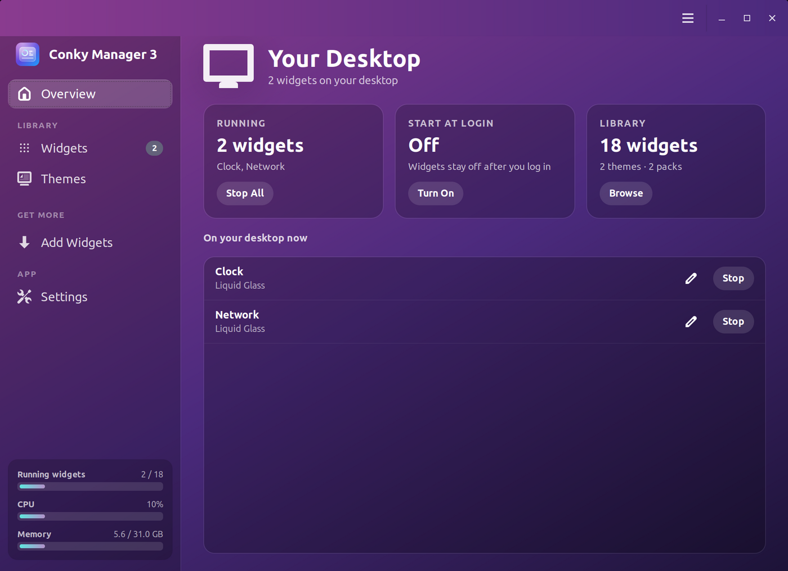
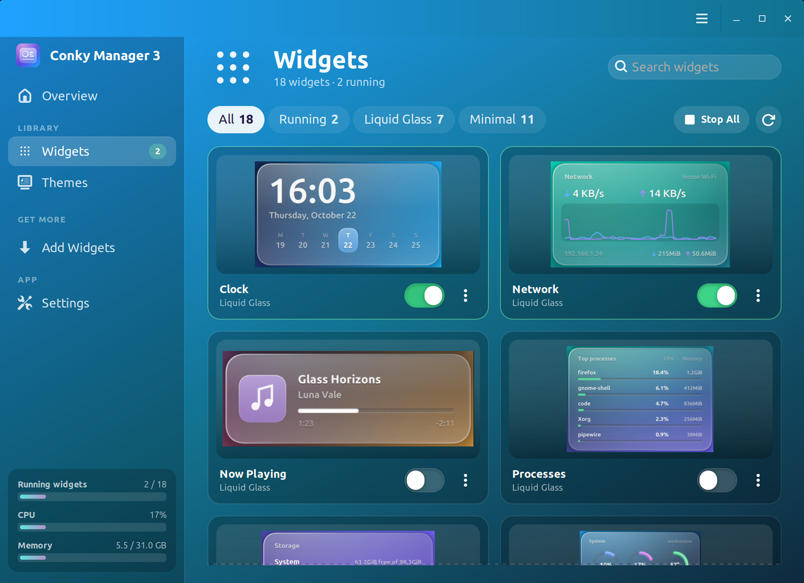
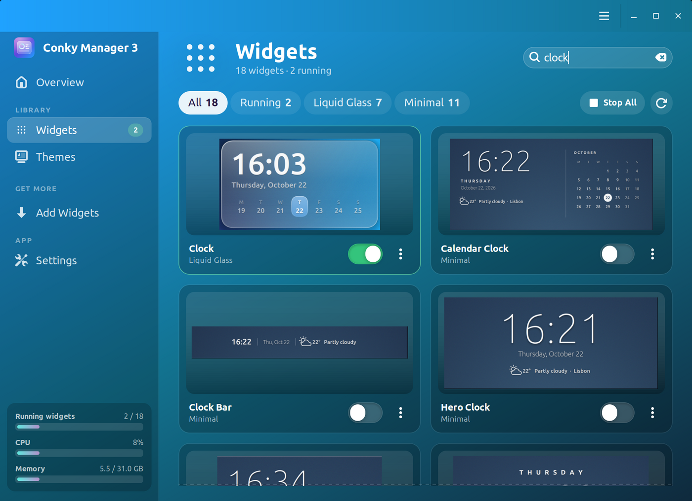
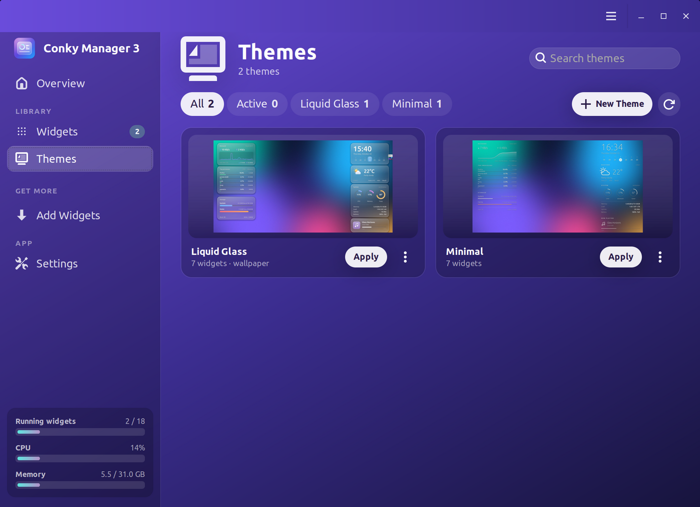
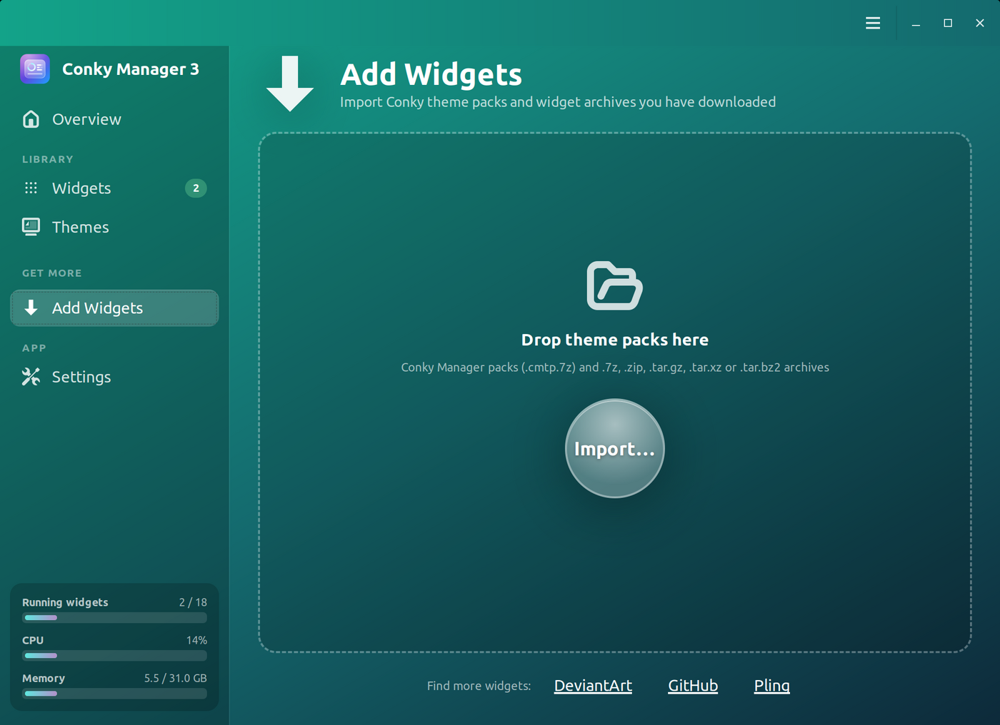
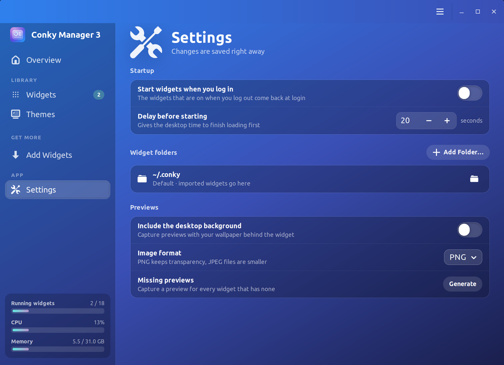
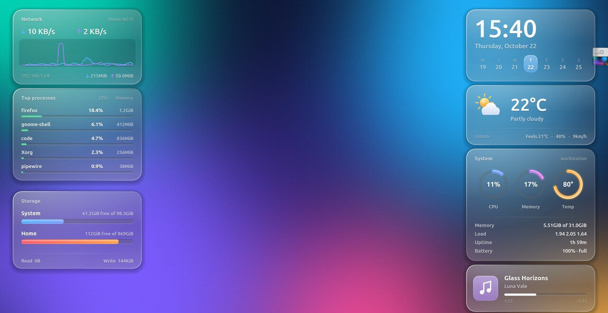
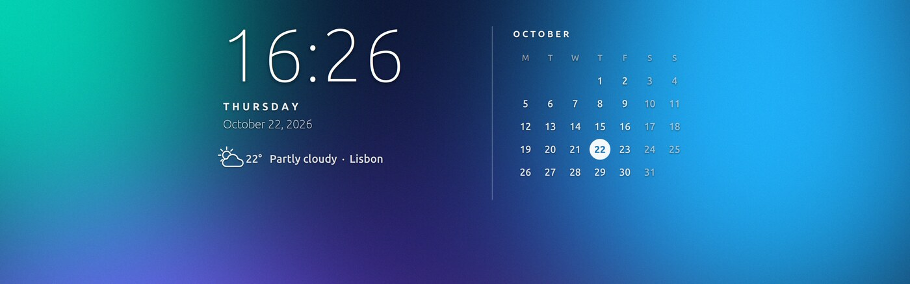

# Conky Manager 3

**Put beautiful widgets on your Linux desktop without touching a config file.**

Conky Manager 3 is a friendly app for [Conky](https://github.com/brndnmtthws/conky), the lightweight desktop widget engine. Browse your widgets as a gallery of previews, flip a switch to show one, apply a whole theme with its wallpaper in one click, and have everything come back when you log in.



## What you can do

- **See your desktop at a glance.** The Overview shows which widgets are on screen, whether they start at login, and what's in your library.
- **Browse widgets as a gallery.** Every widget has a preview card with an on/off switch. Search by name, or filter by pack or by what's running.
- **Adjust widgets without editing files.** Change position, size, transparency, time format and network interface from **Edit Position and Look**.
- **Apply themes.** A theme starts a set of widgets and sets its wallpaper in one click. Turn on the widgets you like and save them as your own theme.
- **Add widgets you download.** Drop `.cmtp.7z`, `.7z`, `.zip` or `.tar.*` packs on the window, or use **Import**.
- **Start at login.** One switch, with an optional delay so your desktop finishes loading first.
- **Works with both config formats.** Classic and Lua (Conky 1.10+) configs are both supported.

| Widget gallery | Search across packs |
| --- | --- |
|  |  |

| Themes | Add widgets | Settings |
| --- | --- | --- |
|  |  |  |

## Widgets included

Two packs come with the app and are added to `~/.conky` the first time it runs.

### Liquid Glass

Frosted glass panels with a bright rim and soft shadow: clock with this week's days, weather, system (CPU, memory, temperature, battery), network speeds with a live graph, storage, top processes, and now playing. Apply the **Liquid Glass** theme to get all of them plus the matching wallpaper. [More about Liquid Glass](themes/liquid-glass)



### Minimal

The same seven widgets in a modern, minimal style, drawn straight on the wallpaper with thin type and hairline gauges. Apply the **Minimal** theme to get them all. Each widget picks white or black text to suit the part of the wallpaper behind it. [More about Minimal](themes/minimal)


The pack also has a **System Monitor** that tracks CPU, GPU, memory, temperatures, fans, disks and network in one widget, and four clocks for the top middle of the screen: **Hero Clock**, **Calendar Clock**, **Weekday Clock** and **Clock Bar**.



Weather in both packs comes from [wttr.in](https://wttr.in) and needs no account or API key.

## Install

Get the files from the [latest release](https://github.com/thuutien/Conky-Manager-3/releases/latest).

**Debian, Ubuntu, Linux Mint, Pop!_OS** (installs Conky and everything else it needs):

```bash
sudo apt install ./conky-manager3_*_amd64.deb
```

**Any distribution:**

```bash
tar xzf conky-manager3-*-x86_64.tar.gz && cd conky-manager3-*/ && sudo ./install.sh
```

**One-line install** (installs dependencies with apt, dnf, pacman or zypper):

```bash
curl -fsSL https://raw.githubusercontent.com/thuutien/Conky-Manager-3/main/packaging/quick-install.sh | sudo bash
```

Then open **Conky Manager 3** from your applications menu, or run `conky-manager3`.

Prebuilt packages are for 64-bit PCs (x86_64) with glibc 2.34 or newer: Ubuntu 22.04, Linux Mint 21, Debian 12 and later. On anything else, [build from source](#build-from-source).

**Coming from conky-manager2?** The package replaces it. Your widgets in `~/.conky` stay put, and your settings are copied over on first run.

### Uninstall

```bash
sudo apt remove conky-manager3
```

Or run `sudo ./install.sh --uninstall` from the extracted tarball. Your widgets in `~/.conky` are not removed.

## Tips

- **A widget won't start or looks wrong?** Use **Run in Terminal** from its **⋯** menu to see Conky's error messages.
- **No preview?** Use **Generate Preview** from its **⋯** menu, or **Generate Missing Previews** from the main menu. It needs ImageMagick and an X11 session.
- **Keep widgets somewhere else?** Add the folder in **Settings → Widget folders**.
- **Updates:** Conky Manager 3 checks for new releases when it starts and shows **Update available** in the sidebar. Use **Check for Updates…** in the menu any time; it downloads the right package, verifies its checksum and installs it after asking for your password. Turn off the startup check in the same menu.
- **Shortcuts:** Ctrl+F searches, F5 rescans your widget folders.

## Build from source

Install the build tools (Debian/Ubuntu names):

```bash
sudo apt install build-essential git valac libgtk-3-dev libgee-0.8-dev libjson-glib-dev gettext conky-all p7zip-full imagemagick rsync
```

Then build and install:

```bash
git clone https://github.com/thuutien/Conky-Manager-3.git
cd Conky-Manager-3
make -C src
sudo ./install.sh
```

To run it without installing, start `src/conky-manager3`. Release packages are built with `packaging/build-deb.sh`, `packaging/build-tarball.sh` and `packaging/build-themepacks.sh`.

## Credits and license

Conky Manager 3 is a fork of [conky-manager2](https://github.com/zcot/conky-manager2) by Scott Caudle, which continued the original Conky Manager by Tony George (teejee2008). It is free software under the GNU General Public License v2 or later (see [COPYING](COPYING)) and comes with no warranty. See [version-history](version-history) for what changed in each release.
