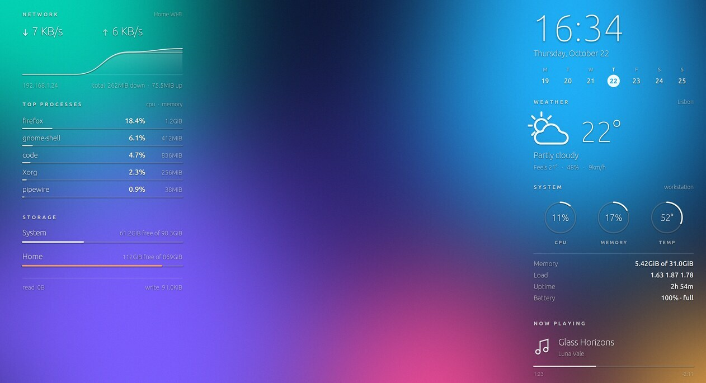
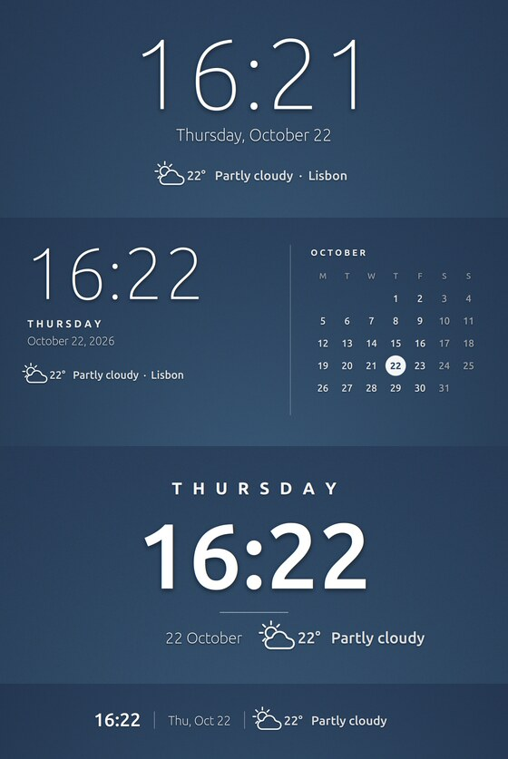

# Minimal widgets

Modern, minimal Conky widgets drawn straight on the wallpaper: thin numerals, letter-spaced labels, hairline gauges and outline weather icons, with no panels.

## Desktop set

The same seven widgets as [Liquid Glass](../liquid-glass), in the minimal style. Apply the **Minimal** theme to turn them all on, or pick the ones you want.

| Widget | Shows | Position |
| --- | --- | --- |
| Week Clock | Time, date and this week with today highlighted | Top right |
| Weather | Conditions, temperature, feels-like, humidity, wind | Right |
| System | CPU, memory and CPU temperature rings; memory, load, uptime, battery | Right |
| Now Playing | Title, artist and progress of the current track (needs `playerctl`) | Right |
| Network | Download/upload speeds with a history graph, Wi-Fi name, IP, totals | Top left |
| Processes | Top 5 processes by CPU, with memory use | Left |
| Storage | Free space on each disk, disk read/write | Left |

## System Monitor

One tall widget that tracks the whole machine, in place of the right-hand column:

- **CPU**: usage with a history graph, a bar per core, model, clock speed and temperature
- **Graphics**: every GPU. NVIDIA (with the NVIDIA driver) and AMD show load, video memory and temperature; Intel shows its current clock against its maximum, since load needs root. A dedicated GPU that is powered down shows as *sleeping* and is not woken up to read it.
- **Memory** and swap
- **Temperatures** from CPU, chipset, NVMe, Wi-Fi and GPU sensors, plus fan speeds
- **Disks**: free space per disk and read/write activity
- **Network** speeds, battery and uptime

Anything your hardware doesn't have is left out. Readings turn orange when they get high (90% load, 85°C).

## Clocks for the top middle

| Widget | Shows |
| --- | --- |
| Hero Clock | Large thin time, date, weather and place, centered |
| Calendar Clock | Time, weekday, date and weather beside this month's calendar |
| Weekday Clock | Letter-spaced weekday over the time, with date and weather |
| Clock Bar | One slim line: time, date and weather |

The four clocks share the top middle, so turn on one at a time. They don't overlap the desktop set, so you can add one to the Minimal theme.

## Text color

The text color follows your wallpaper. Each widget measures the brightness of the part of the wallpaper it sits on (top middle, left or right column) and uses white text on dark areas and black text on light ones, re-checking when the wallpaper changes. This works on Cinnamon, GNOME and MATE. To force a color, set `SETTINGS.text = 'light'` or `'dark'` in `settings.lua`.

## Settings

Edit `settings.lua` in the `Minimal` folder: uncomment a line, change its value, and restart the widget. It covers the 12-hour clock, first day of the week, text color, accent color for today, shadow, weather location and units, hiding the weather, and the network interface. Your `settings.lua` and widget files are kept when the pack is updated. Position and size: `alignment`, `gap_x`, `gap_y`, `minimum_width` and `minimum_height` in each widget file, or **Edit Position and Look** in Conky Manager; a different size zooms the whole widget.

Weather comes from [wttr.in](https://wttr.in) (no API key), refreshed every 15 minutes in the background. It sees your IP address; set a location to avoid IP-based lookup. Needs Conky with Lua and Cairo (`conky-all`), `curl`, and ImageMagick for the automatic text color.

To render the preview images with sample data, start the widgets with `MINIMAL_DEMO=1`.
